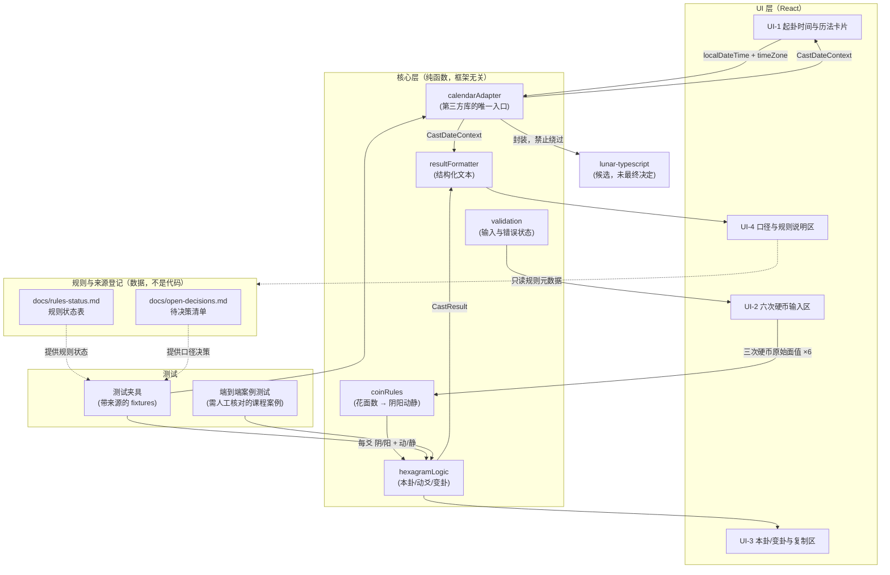
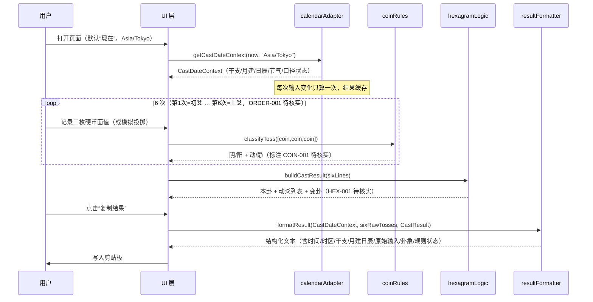

# 架构设计（Phase 0）

> 状态：设计稿，尚未开始实现。本文描述 MVP（含 Phase 1–3）的目标架构，与 `docs/master-plan.md`、`docs/calendar-engine-plan.md` 保持一致。规则状态以 `docs/rules-status.md`、待决策项以 `docs/open-decisions.md` 为准。

## 1. 总体形状

纯静态单页应用，无后端、无运行时网络请求（打开页面不访问任何万年历网站）。所有计算在浏览器本地完成，核心逻辑是**与框架无关的纯函数模块**，可单独在 Node 中跑测试。

```
浏览器
├── UI 层（React 组件，仅展示与交互）
├── 应用层（hooks/控制器：组合输入 → 调用核心模块 → 状态管理）
├── 核心层（纯函数：calendarAdapter / coinRules / hexagramLogic / resultFormatter）
└── 第三方历法库（唯一的外部运行时依赖，被 adapter 完全包裹）
```

## 2. 模块关系



要点：

- **calendarAdapter 是第三方库的唯一入口**。UI 与业务代码只依赖自有类型 `CastDateContext`（见 `docs/calendar-engine-plan.md §2`），不直接 import 历法库。换库只改 adapter。
- **coinRules 的映射数据与判定逻辑分离**：映射表（COIN-001，待核实）是可整体替换的数据；UI 始终保留三枚硬币的原始面值，因此映射修正后历史输入仍可重算。
- **UI 不做任何计算**：组件只消费 `CastDateContext` 和 `CastResult` 两个结果对象，方便快照测试与替换展示层。
- **规则登记文件是数据源**：UI-5 说明区直接读取（构建期或打包为 JSON）规则状态与口径状态，保证页面上显示的「待核实」与现实登记一致，不存在第二份状态表。

## 3. 数据流（一次起卦）



## 4. 目录规划（Phase 2 起）

```
/
├── docs/                      # 现状保持：计划、规则登记、课程笔记、本架构文档
│   ├── ui-mockup.html         # Phase 0 原型（本文档配套）
│   ├── architecture.md
│   └── open-decisions.md
├── src/
│   ├── core/                  # 纯函数核心，无 React 依赖，可独立测试
│   │   ├── calendarAdapter.ts
│   │   ├── castDateContext.ts # 自有类型（与库无关）
│   │   ├── coinRules.ts
│   │   ├── hexagramLogic.ts
│   │   ├── resultFormatter.ts
│   │   └── validation.ts
│   ├── ui/                    # React 组件（按 UI-1…UI-5 拆分）
│   └── rules/                 # 从 docs/rules-status.md 派生的机器可读规则元数据
└── tests/
    ├── fixtures/              # 每条 fixture 注明来源与核查日期
    │   ├── calendar/          # 节气边界、子时、立春、春节、闰年等测试矩阵
    │   └── hexagram/          # 课程核对案例（如 雷水解→山水蒙，待核实）
    └── e2e/                   # 端到端：输入硬币序列 → 页面文本
```

## 5. 技术选型（建议，待确认）

| 项 | 建议 | 理由与状态 |
|---|---|---|
| 构建 | Vite + React + TypeScript | 仓库尚无代码；静态站最简维护路径（`master-plan.md §6`）。**待用户确认后引入** |
| 历法库 | `6tail/lunar-typescript`（候选） | MIT；仍须按 `calendar-engine-plan.md §8` 完成口径测试矩阵后才可采用；版本写入 lockfile，理由记入本文件 |
| 六爻引擎 | 不引入外部六爻引擎 | 排盘规则必须以课程核实为准（Phase 4 逐项），外部项目（如 yaomancy/liuyao-engine）仅作交叉验证参考，不进 bundle |
| 测试 | Vitest | 与 Vite 同生态；核心纯函数 + fixtures + 快照 |
| 状态管理 | React 内置 state | 单页、单次起卦流程，无需全局库 |
| 样式 | 普通 CSS（原型已含响应式方案） | 先可读可验证；不追动画 |

依赖准入：每新增依赖记录理由、版本、许可证；未核实规则不写入 `src/core`。

## 6. 错误与不确定性处理（架构级约束）

1. **不确定口径必须可见**：`CastDateContext.conventionStatus` 为 `provisional/disputed` 时，UI-1 对应字段旁显示「待确认」徽标（原型已画），禁止静默取默认值。
2. **日期不被时区转换悄悄移动**：输入始终是「当地挂钟时间的日期+时分」+ IANA 时区字符串；禁止把日期字符串当 UTC 再转。日柱计算用该时区的本地历日。
3. **无效输入报错而不是回退**：日期无效或时区不可用时显示明确错误；不静默回退到系统时区。
4. **规则缺失时报“未核实”，不猜**：`coinRules`/`hexagramLogic` 的每条分支都携带规则 ID；未登记的规则一律无法通过校验层，UI 显示待核实而不是编造结果。
5. **计算纯函数化**：同一输入恒得同一输出；不依赖系统时间隐式状态（“现在”只在用户点击时采样一次，之后用户选定的时间不被覆盖）。

## 7. 与既有文档的关系

- 本文不新增规则、不确认口径；所有待决策集中在 `docs/open-decisions.md`，规则状态集中在 `docs/rules-status.md`。
- 历法数据契约与准入条件见 `docs/calendar-engine-plan.md`；本文的 calendarAdapter 即其 §7 的落地形态。
- UI 布局依据 `docs/ui-mockup.html`（桌面 1280px / 窄屏 390px，组件编号 UI-1…UI-4 与本文一致）。UI-2 为默认手动模式：六行自下而上（初爻在底），每爻含三枚花/字下拉、纳甲与六亲手选下拉。
