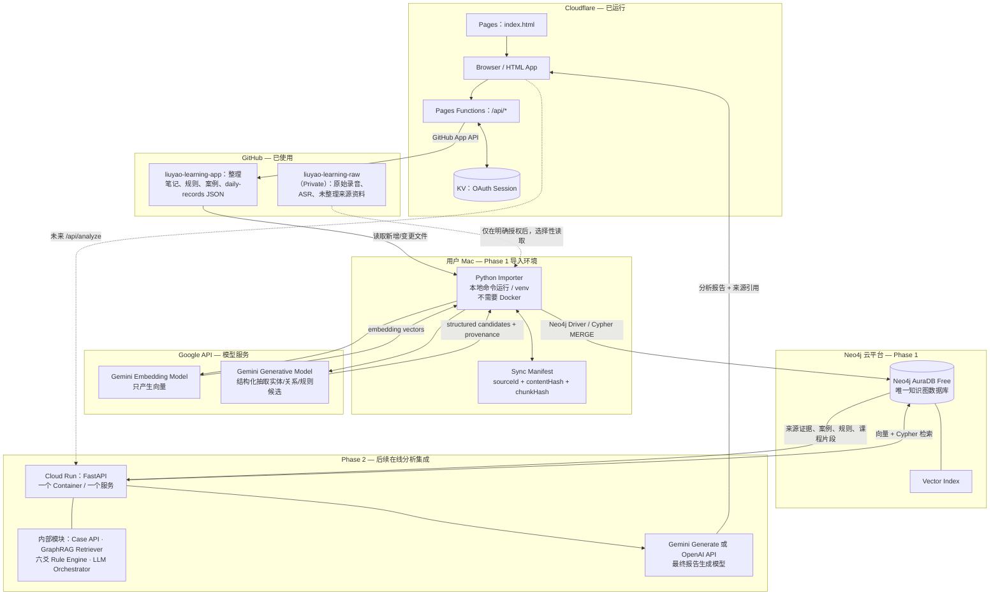

# Phase 1：实际运行架构与知识导入/分析工作流

> 本文是 2026-11-18 起对 Phase 1 部署边界的决策记录。它补充并澄清 `phase1-knowledge-base-architecture.md`、`phase1-deployment.md` 和 `data-model-and-storage.md`。本文件区分“当前已经运行”“Phase 1 要建设”和“Phase 2 才集成”的组件。不得把规划组件描述为已经部署。具体执行顺序、代码目录、验收标准和 Codex 执行要求见 [Phase 1 实施计划](phase1-implementation-plan.md) 与 [Codex Prompt](codex-phase1-implementation-prompt.md)。

## 1. 一句话结论

**Phase 1 不部署新的在线 Backend Container。** 先在用户 Mac 上运行 Python Importer（虚拟环境即可），读取整理后的课程资料、HTML 保存的卦例，以及由独立 Source Collector 采集并经批准的标准 Reference Package；Importer 调用 Gemini 生成模型做结构化抽取，调用 Embedding 模型生成向量，再通过 Neo4j Python Driver 写入 Neo4j AuraDB Free。采集器和知识库 Importer 是两个独立项目，Importer 不直接爬取网页。

- 原始文件和版本来源继续保存在 GitHub。
- Neo4j AuraDB 是 Phase 1 的知识图谱数据库；课程、文本片段、概念、规则候选和案例都可以作为节点/关系存放在同一个 Neo4j 数据库中。
- 暂不需要 Supabase、单独的 PostgreSQL、VPS 或 Docker。
- 当前 HTML 仍通过 Cloudflare Pages Functions 保存每日 JSON 到 GitHub；Phase 1 Importer 再把新增/变更记录同步进 Neo4j。它不是实时双写，也不会在每次浏览器保存时自动连接 Neo4j。
- Phase 1 初期由用户在 Mac 手动启动增量同步；稳定后才考虑 GitHub Actions 或其他自动触发方式。

## 2. 当前、Phase 1、Phase 2 的部署边界



### 已运行的组件

| 组件 | 运行位置 | 责任 |
|---|---|---|
| HTML / JavaScript | Cloudflare Pages | 排卦、表单、记录列表 |
| Pages Functions | Cloudflare Workers Runtime | GitHub OAuth、记录读写 API |
| Session | Cloudflare KV | 保存登录会话 |
| 原始资料、整理笔记、现阶段卦例 JSON | GitHub | 原始/整理文件、版本历史、当前记录持久化 |

Pages Functions 是 Cloudflare 托管的执行环境，不是我们维护的 Docker 容器。

### Phase 1 新增的组件

| 组件 | 部署位置 | 是否 Container |
|---|---|---|
| Python Importer | 用户 Mac，本地手动运行 | 否 |
| Gemini Embedding API | Google 托管 API | 否 |
| Gemini Generative API | Google 托管 API | 否 |
| Neo4j AuraDB Free | Neo4j 托管云数据库 | 否（由 Neo4j 管理） |
| Neo4j LLM Knowledge Graph Builder | 可选在线工具 | 不由我们部署；不是自有 App 后端 |

## 2.1 外部参考采集器：独立 repository

外部网页采集不是知识库 Importer 的职责。拟建独立仓库：`symbi/liuyao-source-collector`（建议先 Private；远端 repository 尚待通过 GitHub UI 或 `gh repo create` 创建）。

**Project A — Source Collector**
- 负责发现并读取经允许访问的古籍网站、网页文本、GitHub README/docs/选定源码及将来经批准的文件下载源。
- 为不同网站实现独立 adapter，处理目录、章节、分页、SPA 页面正文、GitHub 文件路径与版本。
- 提供速率限制、断点续采、页码/章节顺序检查、重复检测、内容哈希和失败报告。
- 只采集符合网站条款、版权许可和访问权限的内容；不绕过登录、付费墙、验证码、访问控制或反爬机制。
- 输出 Reference Package；不做 Chunk、Embedding、LLM 抽取、Neo4j 写入或最终检索。
- 采集全文和网站快照存本机或获准的私有存储，不进入公共代码仓库。

**Project B — 本仓库 Knowledge Base**
- 维护外部 Reference Source Catalog 和 allowlist。
- 验证 Collector 输出的 manifest、版本、内容哈希、原文定位和许可字段。
- 对批准的 Markdown/TXT/源码等进行解析与 Chunk，必要时 Embedding/结构化抽取并写入 Neo4j。
- 不直接访问外部网站，也不承担自动翻页或下载。

**Reference Package v1（拟定）**
```text
reference-package/
  package-manifest.json
  sources/<source-id>/
    source.json
    documents/<chapter-or-file-id>.md
```

Package manifest 至少包含 package/schema ID、collector 名称/版本、生成时间、source_id、标题/作者、canonical URL、具体章节/文件 URL、版本/commit、采集时间、版权状态、允许云端处理/再分发标记、内容哈希和原文定位。没有许可依据或不允许云端处理的资料可以登记但不得送入 Gemini。Package v1 schema 以 [外部参考资料来源目录](reference-source-catalog.md) 为设计依据。

> GitHub 集成当前不提供直接创建 repository 的操作；本次已确定仓库名称和职责，但远端创建尚未完成。不得把计划中的 Collector repository 说成已存在。

## 3. Importer 的输入、处理和输出

### 输入

Phase 1 必须把课程资料的两个来源轨道分开保存，不能把原始 ASR 和整理后的课堂笔记当成同一份 Document。

**Source A：Raw ASR（Private raw）**

- 原始课堂录音保存在 `liuyao-learning-raw`，作为音频来源文件，不直接切成文本 Chunk。
- ASR 转写文字也保存在 Private raw，当前识别质量有限（用户估计约 70%），标记为 `raw_asr / low_confidence / unverified`。
- 初期默认只保留原文、版本、课程 ID 和回查位置；不进入主要规则抽取，也不作为老师确认规则的证据。
- 未来确实需要查找原话时，可以单独生成 RawChunk 和低置信度向量索引，查询时与整理笔记分开显示、分开过滤。

**Source B：Curated Lesson Notes（Learning）**

- ChatGPT 根据课堂上下文整理、修订后的正式笔记，保存在 `docs/lessons/`。
- 这是 Phase 1 默认执行 Chunk、Embedding 和候选知识抽取的主要课堂来源。
- 每个文件保留 lessonId、文件路径、标题、段落位置，以及能够回查 Raw 来源的引用。

另外还有：

1. **HTML 卦例 JSON**：从 `daily-records/` 或后续案例目录读取。用 Case Mapper 按结构化字段写入 Case 节点，不让 LLM 重新猜测卦盘字段。
2. **外部 Reference Package**：只导入由独立 Source Collector 输出、且 Source Catalog 明确批准的章节文本、网页正文、README/docs 或选定源码。必须保留原始 URL、版本/commit、章节/文件 locator、许可状态和内容哈希。知识库 Importer 不直接爬取网页。
3. **PDF**：当前没有已确认要导入的 PDF，因此 PDF Adapter 与 OCR 暂缓；只有用户指定具体文件、确认版本及使用权后再单独立项。
3. **外部 GitHub 参考项目**：可以参考，但不能把整个 Repository 当成一篇长文。先登记仓库 URL、作者、License、commit SHA，再选择 README、docs、规则文件和有价值源码。README/Markdown 按标题和段落切块；源码按文件、类、函数或符号边界切块。所有内容标记为 `external_reference`，不能混入老师课堂规则。

### 处理

```text
新增 / 修改文件
  -> Source Scanner：识别仓库、路径和稳定 documentId
  -> Sync Manifest：计算 revisionHash / contentHash
  -> Source Gate：按 sourceType / trustLevel 分流
       ├─ Raw ASR：默认只登记来源与版本，不进入主抽取流程
       ├─ Curated Notes：Markdown Parser -> Chunker -> Curated Chunks
       ├─ Case JSON：Case Mapper -> 结构化 Case
       └─ Reference Package：验证 manifest/rights/hash 后，按选定文件处理，标记 external
  -> 对 Curated Chunk 并行执行两条路径：
       ├─ Embedding Model：Chunk -> Vector -> 写入 Chunk / Vector Index
       └─ Generative LLM：Chunk -> 候选 Concept / Entity / Relation / RuleCandidate
  -> 把抽取结果连接回来源 Chunk / DocumentRevision
  -> Neo4j MERGE / 更新版本 / 标记 superseded
```

Chunk 是共同的基础文本单位。Embedding 和候选知识抽取不是二选一，而是同一 Chunk 的两条并行处理路径：
- Embedding 路径产生数值向量，供语义相似检索。
- Generative LLM 路径产生候选概念、实体、关系、规则陈述和摘要，并且必须保留来源 Chunk。
### 输出

不是只有“节点和关系”。Neo4j 中至少会保存：

- `Lesson`：课程课次。
- `SourceDocument`：文档 ID、仓库/路径、版本、内容哈希、来源类别。
- `Chunk`：文本片段、原文位置、所属文档、Embedding。
- `Case`：课堂案例或个人练习，包含卦盘字段、问题、Memo、日期、案例类型和来源。
- `Concept`：六亲、六神、日辰、月建、暗动等概念。
- `RuleCandidate` / `Rule`：从课程材料抽取的规则陈述、适用条件、来源和状态。
- 节点之间的关系，例如 `HAS_CHUNK`、`MENTIONS`、`TAUGHT_IN`、`ILLUSTRATES`、`SUPPORTED_BY`。
- 向量索引，用于相似文本检索。

每一条抽取的关系都应该保留来源 Chunk。检索结果能回到相应课次、文件和段落，而不是只留下一个脱离来源的 AI 结论。

## 4. 增量更新与文档版本：不会每次重新导入全部资料

Importer 必须设计成幂等，并维护同步清单：

- `documentId`：稳定标识同一个来源文件（例如 repo/path）。
- `revisionHash`：某一次文件内容的哈希；文件变化就产生新 revision。
- `chunkId`：来源身份 + chunking 版本 + 规范化片段身份。
- `recordId`：案例记录本身的稳定 ID。

| 情况 | Importer 行为 |
|---|---|
| 新增第 18 课 | 只处理第 18 课 |
| 文件未变化 | 跳过，不重新请求 Embedding / LLM |
| 文件有修改 | 建立新 revision；变化的 Chunk 重新处理，未变化 Chunk 尽量复用 |
| Raw ASR v1 升级为 v2 | 保留 v1，新建 v2；不覆盖原始版本 |
| 旧版 Chunk 不再属于当前版本 | 标记 superseded，保留历史，默认检索时不优先返回 |
| 新增一条案例 | 按稳定 recordId 新增 Case |
| 案例 Memo 或卦盘修改 | 更新同一个 Case，不产生重复 Case |
| 外部项目新增文档 | 只导入选定的新文件，仍然标记 external |

举例：以后你用更好的模型重新转写第 17 课，Raw Transcript v2 会成为一个新版本。Importer 比较新旧文本，变化的 Chunk 才重新生成 Embedding 和候选知识；相同内容可以复用。旧版仍保留为历史，不与 Curated Lesson Notes 混源。

初版由用户在 Mac 手动运行同步命令；后续可考虑 GitHub Actions 自动触发。当前 HTML 保存动作不会自动触发 Importer。
## 5. Gemini：Embedding 与内容生成是两种不同任务

这里的 Generative LLM 就是真正的大语言模型，不是一个专门“生成规则”的工具。导入阶段只是让它执行结构化抽取，因此输出通常是候选 Concept、Entity、Relationship、RuleCandidate 和摘要；相同类别的生成模型以后也可以在分析阶段阅读检索证据并写最终报告。Phase 1 先不让它承担最终卦象分析。


Importer 会使用两个独立的模型能力：

1. **Embedding Model**：输入文本，输出向量。用于把文档 Chunk 和之后的用户问题映射到可比较的向量空间。它不会写分析报告，也不会单独判断六爻规则。
2. **Generative Model（例如 Gemini 的生成模型）**：输入文本和结构化提取指令，生成候选实体、关系、规则陈述或摘要。未来也可以生成分析报告，但这是另一种调用，不是 Embedding 的功能。

模型名称、维度、配额和数据使用条款在实际启用前再按当时官方文档确认。不要把 API Key 放入 HTML、浏览器代码或 Public GitHub。私人录音和含个人信息的资料，在确认数据处理条款前不要直接送入免费 API 服务。

## 6. Neo4j、Knowledge Graph Builder 和 GraphRAG 是三样不同的东西

- **Neo4j** 是数据库产品。AuraDB Free 是 Neo4j 托管的云端图数据库，保存节点、关系、属性、文本 Chunk 和 Embedding。
- **LLM Knowledge Graph Builder** 是可选的图谱构建应用。它可以加载 PDF/文档、切 Chunk、调用 Embedding、调用生成式 LLM 抽取节点和关系，并把结果写进 Neo4j。它不是 Neo4j 数据库本身。
- **GraphRAG** 是检索增强生成框架/方法。它使用 Retriever 从 Neo4j 找相关节点、关系和文本上下文，再把上下文交给 Generative LLM 生成回答。它不是数据库，也不等于 Embedding。

## 7. Knowledge Graph Builder 是否必须使用？

**不必须。它不只是可视化器，但也不是我们必须依赖的基础设施。**

Neo4j LLM Knowledge Graph Builder 在线工具可以：

- 读取 PDF、文档、网页或 YouTube 转写等资料；
- 把资料切成 Document / Chunk；
- 生成 Embedding；
- 使用选定的 LLM 抽取实体和关系；
- 把 Document、Chunk、实体和关系写到你连接的 Neo4j 数据库；
- 在界面里预览 lexical graph、entity graph 和 full graph；
- 提供基于已导入数据的 RAG 聊天入口。

它的在线 React 前端和 Python FastAPI 后端由 Neo4j Labs 托管（后端运行在 Google Cloud Run），连接到我们自己的 AuraDB；这不需要部署在你的 Google Cloud 账户里。它不是只负责画图的插件，也不是我们自建 App 的后端。Neo4j 当前开发者资料将其标注为 Labs/社区工具，而不是官方支持的生产级托管产品，因此我们只把它作为可选试验工具。

但 Neo4j 将它定位为 Labs 项目/社区工具，官方资料对生产场景也介绍了 Aura Document Intelligence 等其他方案。因此本项目建议：

- 用少量整理过的课程材料做一次试验，看看节点、关系和图形预览是否有助于理解。
- 不把它作为唯一或长期导入流水线。
- 正式同步仍由我们自己的 Python Importer 控制，因为我们需要特殊的六爻 Schema、案例分类、稳定 ID、增量更新、来源追溯和历史版本。

在线入口：<https://llm-graph-builder.neo4jlabs.com/>

Builder 是可选构建工具，不是 AuraDB，也不是 GraphRAG。我们可以完全不用 Builder，由 Python Importer + Neo4j Driver/Cypher 直接写入 Neo4j。Aura Console / Neo4j Browser 可以执行 Cypher、查看和可视化节点关系；但你日常分析卦不需要手动浏览整张图。

## 8. “谁来分析卦？”——Phase 1 和 Phase 2 的区别

### Phase 1：可以进行知识辅助分析，但采用半自动交接

Phase 1 不只是建库，也可以逐步做出可用的知识检索流程：

1. HTML 保存卦例到 GitHub（现有流程）。
2. Mac 上的 Python Query Tool 读取用户选定的卦盘/问题，并用同一个 Embedding 模型把问题向量化。
3. Query Tool 连接 AuraDB，执行 Vector Search + Cypher 图关系查询，按来源等级优先返回整理后的课程笔记和课堂案例；个人练习、外部项目和 Raw ASR 分开标记。
4. Query Tool 生成带课次、文件路径、原文片段和案例出处的 Evidence Pack。
5. 用户把卦盘 + Evidence Pack 提供给 ChatGPT 网页版，由 ChatGPT 完成最终分析报告。

也就是说 Phase 1 可以支持“基于知识库的卦例辅助分析”，不必等到 Phase 2；但 Query Tool 需要在 Importer 之后增加，而且用户要把检索结果交给 ChatGPT。**当前 ChatGPT 网页版不会自行直连 AuraDB，现有 HTML 也还没有自动触发这条查询链。**

没有知识库检索时，你仍然可以像现在一样直接把卦例、笔记和问题交给 ChatGPT 分析；Phase 1 的价值是逐步让资料查找更系统、更可追溯。

### Phase 2：如果希望 HTML 页面里直接出现 AI 分析报告

后续在 Cloud Run 部署一个 Python FastAPI 服务。初期一个服务、一个 Container 即可，内部拆成普通 Python 模块：

- Case API：案例保存/读取/更新。
- GraphRAG Retriever：对问题做 Embedding，再用 Neo4j 向量索引、Cypher 和图关系取回相关课程/案例/规则。
- Rule Engine：执行已明确编码的确定性六爻计算。
- LLM Orchestrator：把卦盘、规则计算结果和检索到的来源证据交给生成模型，生成报告。

数据流：

```text
HTML
  -> Cloud Run FastAPI
      -> Rule Engine（确定性计算）
      -> GraphRAG Retriever
          -> Embedding Model（把问题向量化）
          -> Neo4j AuraDB（检索节点、关系、Chunk 和来源）
      -> Generative LLM（Gemini Generate 或 OpenAI API）
  <- 分析报告、来源课次/段落、外部参考区分和不确定性提示
```

GraphRAG 是“检索相关知识 + 把上下文交给 LLM”的应用框架，不是独立大模型。要生成最终答案，仍必须配置一个生成模型。这个生成模型可以是 Gemini，也可以是 OpenAI API；ChatGPT 网页订阅和 API 调用是两种不同服务。

## 9. Neo4j 本地能否运行？为什么仍建议 AuraDB？

Neo4j **可以本地运行**，并不是只能使用云服务。可以安装 Neo4j Desktop，在 Mac 上创建本地数据库；也可以通过官方 Docker 镜像运行。Neo4j Desktop 官方定位为本地开发环境，可以管理本地数据库，也可以连接 Aura 等远程数据库。参考：[Neo4j Desktop](https://neo4j.com/docs/desktop/current/) 和 [Neo4j Deployment Center](https://neo4j.com/deployment-center/)。

两种选择：

- **本地 Neo4j Desktop**：适合学习 Cypher、试验节点/关系、测试导入脚本。数据库通常只在这台 Mac 可访问；以后要让 Cloud Run 访问，需要额外网络配置，或迁移数据到云端。
- **Neo4j AuraDB Free**：适合作为这个项目的共享主库。Mac Importer、以后 Cloud Run Backend 和可选 Graph Builder 都能连接同一个数据库。官方当前列出的 Free 上限为 200,000 nodes、400,000 relationships、1GB storage；没有 SLA，备份为 on-demand。实际启用前仍需检查当时套餐与功能限制。

**建议 AuraDB Free 作为唯一主知识库；Neo4j Desktop 可选用于本地学习，不长期维护两份不同步的主数据库。**

AuraDB Free 支持建立基础 Vector Index 并执行向量检索；Professional 等付费层额外提供 Vector Optimization 性能优化。我们先用 Free 验证 Chunk + 向量索引 + Cypher 关系查询即可，不要把免费层没有性能优化误解为完全不能用 Vector Index。正式创建时仍应在 Aura Console 核对当前套餐能力。

### 是否需要 Supabase？

Neo4j AuraDB 本身就是数据库，只是图数据库而不是关系型数据库。Phase 1 的知识实体（Lesson、Document、Chunk、Concept、RuleCandidate、Case）和关系都可以放在 Neo4j；当前 HTML 的每日 JSON 仍由现有 Cloudflare Pages Function 保存到 GitHub，Importer 再把其同步成 Case 节点。

Phase 1 不需要额外部署 PostgreSQL / Supabase。只有将来需要多用户身份、严格用户数据隔离或典型关系型业务数据时，才重新评估 Supabase。
## 10. 不要求用户手工审核每一条 AI 抽取结果

用户不需要理解每个节点或关系，也不需要逐条批准 Neo4j 图谱内容才能使用系统。

我们改用来源分级和自动证据标注：

| 来源类别 | 系统如何使用 |
|---|---|
| ChatGPT 整理后、保存到 Learning 的课程笔记 | 主要课程检索来源；保留课次和文档定位 |
| 老师课堂案例 + 用户录入的课堂 Memo | 课堂案例来源；标记为老师讲解过，但 Memo 仍是课堂笔记记录，不冒充逐字原话 |
| 未校对 ASR | 低置信度回查线索；术语、数字和爻位可标记不确定 |
| 个人练习案例 | 个人经验数据；不自动当成老师规则依据 |
| 外部 GitHub 项目/资料 | 外部参考；必须显示项目/作者/链接/License，不混成老师的课程口径 |
| AI 自动抽取的概念、关系、规则候选 | 保留来源 Chunk、抽取模型和状态；不能仅凭 AI 抽取就变成已确认课程规则 |

最终分析需要优先引用课程笔记和课堂案例，指出它来自哪一课、哪一段；若不同来源冲突或 ASR 不确定，报告中直接说明分歧。用户只需在 HTML 中标记“课堂案例”还是“个人练习”，不需要承担数据库知识审核工作。

## 11. 实施顺序

具体里程碑、代码目录、配置、安全边界和验收标准已经整理为独立的 [Phase 1 工程实施计划](phase1-implementation-plan.md)，Codex 本机执行说明见 [Codex Phase 1 Prompt](codex-phase1-implementation-prompt.md)。

执行顺序如下：

1. M0：用户创建 Neo4j AuraDB Free，在 Mac 本机安全配置凭据；先做连接与 Vector Index smoke test。
2. M1–M3：建立 Python CLI、来源 Parser、Chunker、Neo4j Schema 和唯一约束。
3. M4：先完成不依赖模型调用的增量 Importer 核心，验证 Hash、Revision、Chunk ID、MERGE 和重复运行。
4. M5：对 Curated Chunk 并行执行 Gemini Embedding 和 Generative LLM 候选知识抽取。
5. M6：按 allowlist 导入经过 Source Catalog 审核、由 Collector 输出的 Reference Package（古籍章节、网页文字、选定 GitHub 文档/源码）；保留来源、版本和 License。PDF 当前不在验收范围。
6. M7：实现本地 Query Tool，生成可交给 ChatGPT 网页版的 Evidence Pack。
7. M8：用真实课程、真实课堂案例和用户允许的参考资料完成端到端验收。

Phase 2 的 Cloud Run 在线 API 不属于本阶段，不阻塞 Phase 1 的知识库辅助分析。
 
## 官方技术参考

- Neo4j Graph Database：<https://neo4j.com/docs/getting-started/graph-database/>
- Neo4j GraphRAG for Python：<https://neo4j.com/docs/neo4j-graphrag-python/current/>
- GraphRAG RAG pipeline（Retriever + LLM）：<https://neo4j.com/docs/neo4j-graphrag-python/current/user_guide_rag.html>
- Neo4j LLM Knowledge Graph Builder：<https://neo4j.com/developer/genai-ecosystem/llm-graph-builder/>
- Neo4j Knowledge Graph construction overview：<https://neo4j.com/developer/genai-ecosystem/importing-graph-from-unstructured-data/>
- Gemini API pricing and model details：<https://ai.google.dev/gemini-api/docs/pricing>
