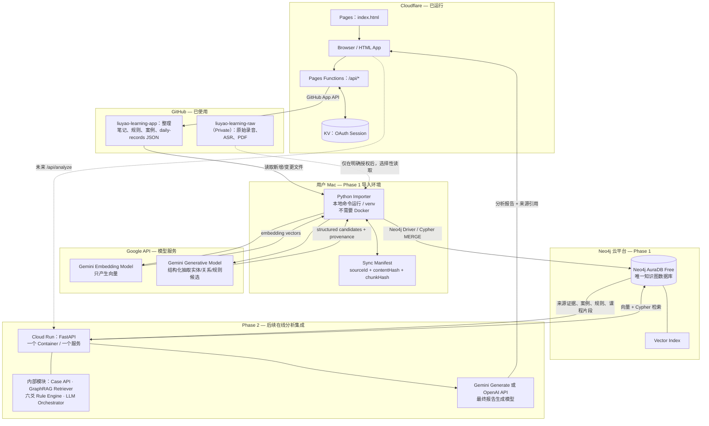

# Phase 1：实际运行架构与知识导入/分析工作流

> 本文是 2026-11-18 对 Phase 1 部署边界的决策记录。它补充并澄清 `phase1-knowledge-base-architecture.md`、`phase1-deployment.md` 和 `data-model-and-storage.md`。本文件区分“当前已经运行”“Phase 1 要建设”和“Phase 2 才集成”的组件。不得把规划组件描述为已经部署。

## 1. 一句话结论

**Phase 1 不部署新的在线 Backend Container。** 先在用户 Mac 上运行一个 Python Importer（虚拟环境即可），从 GitHub 读取整理后的课程资料、HTML 保存的卦例和选定的外部参考资料；Importer 调用 Gemini 的生成模型做结构化抽取，调用 Embedding 模型生成向量，再通过 Neo4j Python Driver 把结果写入 Neo4j AuraDB Free 云数据库。

- 原始文件和版本来源继续保存在 GitHub。
- Neo4j AuraDB 是 Phase 1 的知识图谱数据库；课程、文本片段、概念、规则候选和案例都可以作为节点/关系存放在同一个 Neo4j 数据库中。
- 暂不需要 Supabase、单独的 PostgreSQL、VPS 或 Docker。
- 当前 HTML 仍通过 Cloudflare Pages Functions 保存每日 JSON 到 GitHub；Phase 1 Importer 再把新增/变更记录同步进 Neo4j。它不是实时双写，也不会在每次浏览器保存时自动连接 Neo4j。
- Phase 1 初期由用户在 Mac 手动启动增量同步；稳定后才考虑 GitHub Actions 或其他自动触发方式。

## 2. 当前、Phase 1、Phase 2 的部署边界



### 已运行的组件

| 组件 | 运行位置 | 责任 |
|---|---|---|
| HTML / JavaScript | Cloudflare Pages | 排卦、表单、记录列表 |
| Pages Functions | Cloudflare Workers Runtime | GitHub OAuth、记录读写 API |
| Session | Cloudflare KV | 保存登录会话 |
| 原始资料、整理笔记、现阶段卦例 JSON | GitHub | 原始/整理文件、版本历史、当前记录持久化 |

Pages Functions 是 Cloudflare 托管的执行环境，不是我们维护的 Docker 容器。

### Phase 1 新增的组件

| 组件 | 部署位置 | 是否 Container |
|---|---|---|
| Python Importer | 用户 Mac，本地手动运行 | 否 |
| Gemini Embedding API | Google 托管 API | 否 |
| Gemini Generative API | Google 托管 API | 否 |
| Neo4j AuraDB Free | Neo4j 托管云数据库 | 否（由 Neo4j 管理） |
| Neo4j LLM Knowledge Graph Builder | 可选在线工具 | 不由我们部署；不是自有 App 后端 |

## 3. Importer 的输入、处理和输出

### 输入

1. **整理后的课堂笔记**：`docs/lessons/` 中由课堂材料整理、校对后保存的 Markdown。
2. **HTML 录入的卦例**：GitHub `daily-records/` 中的 JSON，以及后续整理成独立案例的 JSON。包含课堂案例/个人练习标签、卦盘快照、Memo 和日期等。
3. **外部 GitHub 参考项目**：只导入明确选择的项目 README、文档或指定代码文件。记录仓库 URL、作者、License 和来源类别，不把外部项目内容混成老师课堂规则。
4. **Private raw 来源**：默认只保留来源引用。只有在确实需要回查并明确配置了私有仓库访问时，才选择性读取原始转写/资料；不把 Private raw 内容直接复制到 Public 仓库。

### 处理

```text
新文件 / 修改过的文件
  -> 识别来源（repo + path + revision）
  -> 计算 content hash
  -> 读取文本 / JSON
  -> 文本切块（Chunk）并保留页码、标题或段落定位
  -> Gemini Generative Model：抽取候选概念、关系、规则和摘要
  -> Gemini Embedding Model：为文本片段生成向量
  -> 规范化 ID、实体去重、检查来源链
  -> Neo4j MERGE / 更新版本 / 标记过期片段
```

### 输出

不是只有“节点和关系”。Neo4j 中至少会保存：

- `Lesson`：课程课次。
- `SourceDocument`：文档 ID、仓库/路径、版本、内容哈希、来源类别。
- `Chunk`：文本片段、原文位置、所属文档、Embedding。
- `Case`：课堂案例或个人练习，包含卦盘字段、问题、Memo、日期、案例类型和来源。
- `Concept`：六亲、六神、日辰、月建、暗动等概念。
- `RuleCandidate` / `Rule`：从课程材料抽取的规则陈述、适用条件、来源和状态。
- 节点之间的关系，例如 `HAS_CHUNK`、`MENTIONS`、`TAUGHT_IN`、`ILLUSTRATES`、`SUPPORTED_BY`。
- 向量索引，用于相似文本检索。

每一条抽取的关系都应该保留来源 Chunk。检索结果能回到相应课次、文件和段落，而不是只留下一个脱离来源的 AI 结论。

## 4. 增量更新：不是每次重新导入全部资料

Importer 必须设计成幂等（同一批数据重复运行不会无限复制），并维护同步清单：

- `sourceId`：稳定标识，例如 `repo/path`。
- `contentHash`：识别文档内容是否变化。
- `chunkId`：根据 sourceId、片段位置/内容生成稳定 ID。
- `recordId`：案例记录本身的稳定 ID。

运行策略：

| 情况 | Importer 行为 |
|---|---|
| 新增第 18 课 | 只解析、切分、抽取和写入第 18 课 |
| 文件未变化 | 跳过，不重新请求 Embedding / LLM |
| 文件有修改 | 只处理新增/改变的 Chunk；旧片段标记为 superseded 或按版本策略替换 |
| 新增一条案例 | 按稳定 recordId 新增/更新一个 Case，并建立关系 |
| 案例 Memo 或卦盘修改 | 更新同一个 Case，不产生重复 Case |
| 外部项目新增文档 | 只导入选定的新文件，标记为 external reference |
| 规则被后续课程修订 | 保留旧来源和版本，建立修订/替代关系，不静默抹去历史 |

初版触发方式：用户在 Mac 手动运行同步命令。后续可以通过 GitHub Actions 在整理笔记或案例 JSON 更新后触发。**当前 HTML 的保存动作还不会自动触发 Importer。**

## 5. Gemini：Embedding 与内容生成是两种不同任务

Importer 会使用两个独立的模型能力：

1. **Embedding Model**：输入文本，输出向量。用于把文档 Chunk 和之后的用户问题映射到可比较的向量空间。它不会写分析报告，也不会单独判断六爻规则。
2. **Generative Model（例如 Gemini 的生成模型）**：输入文本和结构化提取指令，生成候选实体、关系、规则陈述或摘要。未来也可以生成分析报告，但这是另一种调用，不是 Embedding 的功能。

模型名称、维度、配额和数据使用条款在实际启用前再按当时官方文档确认。不要把 API Key 放入 HTML、浏览器代码或 Public GitHub。私人录音和含个人信息的资料，在确认数据处理条款前不要直接送入免费 API 服务。

## 6. Knowledge Graph Builder 是否必须使用？

**不必须。它不只是可视化器，但也不是我们必须依赖的基础设施。**

Neo4j LLM Knowledge Graph Builder 在线工具可以：

- 读取 PDF、文档、网页或 YouTube 转写等资料；
- 把资料切成 Document / Chunk；
- 生成 Embedding；
- 使用选定的 LLM 抽取实体和关系；
- 把 Document、Chunk、实体和关系写到你连接的 Neo4j 数据库；
- 在界面里预览 lexical graph、entity graph 和 full graph；
- 提供基于已导入数据的 RAG 聊天入口。

它的在线 React 前端和 Python FastAPI 后端由 Neo4j Labs 托管（后端运行在 Google Cloud Run），连接到我们自己的 AuraDB；这不需要部署在你的 Google Cloud 账户里。它不是只负责画图的插件，也不是我们自建 App 的后端。Neo4j 当前开发者资料将其标注为 Labs/社区工具，而不是官方支持的生产级托管产品，因此我们只把它作为可选试验工具。

但 Neo4j 将它定位为 Labs 项目/社区工具，官方资料对生产场景也介绍了 Aura Document Intelligence 等其他方案。因此本项目建议：

- 用少量整理过的课程材料做一次试验，看看节点、关系和图形预览是否有助于理解。
- 不把它作为唯一或长期导入流水线。
- 正式同步仍由我们自己的 Python Importer 控制，因为我们需要特殊的六爻 Schema、案例分类、稳定 ID、增量更新、来源追溯和历史版本。

在线入口：<https://llm-graph-builder.neo4jlabs.com/>

## 7. “谁来分析卦？”——Phase 1 和 Phase 2 的区别

### Phase 1：仍然由当前 ChatGPT 对话负责最终分析

Phase 1 的重点是把知识库建起来，不是自动分析服务。

- 用户照常在 HTML 排卦和保存。
- Importer 把整理资料和案例同步进 AuraDB。
- 用户仍可以把卦例和需要的课程资料交给 ChatGPT，由 ChatGPT 生成最终分析。
- **此时 ChatGPT 网页版不会自动连接我们新建的 AuraDB。** 除非另行做查询工具/连接器，否则不能声称它已经能直接读取知识图谱。

因此 Phase 1 不需要 Gemini 来写最终报告，也不要求先做 Phase 2 才能继续请 ChatGPT 分析。

### Phase 2：如果希望 HTML 页面里直接出现 AI 分析报告

后续在 Cloud Run 部署一个 Python FastAPI 服务。初期一个服务、一个 Container 即可，内部拆成普通 Python 模块：

- Case API：案例保存/读取/更新。
- GraphRAG Retriever：对问题做 Embedding，再用 Neo4j 向量索引、Cypher 和图关系取回相关课程/案例/规则。
- Rule Engine：执行已明确编码的确定性六爻计算。
- LLM Orchestrator：把卦盘、规则计算结果和检索到的来源证据交给生成模型，生成报告。

数据流：

```text
HTML
  -> Cloud Run FastAPI
      -> Rule Engine（确定性计算）
      -> GraphRAG Retriever
          -> Embedding Model（把问题向量化）
          -> Neo4j AuraDB（检索节点、关系、Chunk 和来源）
      -> Generative LLM（Gemini Generate 或 OpenAI API）
  <- 分析报告、来源课次/段落、外部参考区分和不确定性提示
```

GraphRAG 是“检索相关知识 + 把上下文交给 LLM”的应用框架，不是独立大模型。要生成最终答案，仍必须配置一个生成模型。这个生成模型可以是 Gemini，也可以是 OpenAI API；ChatGPT 网页订阅和 API 调用是两种不同服务。

## 8. Neo4j 是不是唯一数据库？要不要 Supabase？

Neo4j AuraDB 本身就是一个托管云数据库，只不过它是**图数据库**，不是关系型数据库：

- 关系型数据库常见结构是表、行、列；
- Neo4j 的核心结构是节点、关系和属性；
- 一个 Case 节点可以保存日期、案例类型、问题、卦盘快照、Memo 等属性，再通过关系连接到 Lesson、Chunk、Rule 和 Concept。

**Phase 1 的知识库只需要 Neo4j AuraDB，不需要额外 PostgreSQL / Supabase。** 目前 HTML 的每日 JSON 仍暂存在 GitHub，这属于现有文件持久化方式；Importer 会把这些记录同步成 Neo4j 中的知识实体。原始录音/PDF 等大文件仍保留在 GitHub raw 或未来对象存储。

未来如果需要多用户账号、严格用户隔离、私人日记、复杂交易式用户数据，再评估 Supabase/PostgreSQL。它不是开始 Phase 1 的前置条件。单用户知识图谱和课堂/练习案例本身可以先由 Neo4j 承载。

## 9. 不要求用户手工审核每一条 AI 抽取结果

用户不需要理解每个节点或关系，也不需要逐条批准 Neo4j 图谱内容才能使用系统。

我们改用来源分级和自动证据标注：

| 来源类别 | 系统如何使用 |
|---|---|
| ChatGPT 整理后、保存到 Learning 的课程笔记 | 主要课程检索来源；保留课次和文档定位 |
| 老师课堂案例 + 用户录入的课堂 Memo | 课堂案例来源；标记为老师讲解过，但 Memo 仍是课堂笔记记录，不冒充逐字原话 |
| 未校对 ASR | 低置信度回查线索；术语、数字和爻位可标记不确定 |
| 个人练习案例 | 个人经验数据；不自动当成老师规则依据 |
| 外部 GitHub 项目/资料 | 外部参考；必须显示项目/作者/链接/License，不混成老师的课程口径 |
| AI 自动抽取的概念、关系、规则候选 | 保留来源 Chunk、抽取模型和状态；不能仅凭 AI 抽取就变成已确认课程规则 |

最终分析需要优先引用课程笔记和课堂案例，指出它来自哪一课、哪一段；若不同来源冲突或 ASR 不确定，报告中直接说明分歧。用户只需在 HTML 中标记“课堂案例”还是“个人练习”，不需要承担数据库知识审核工作。

## 10. 实施顺序

1. 完成 HTML 清空/新建/保存保护，确保旧卦不会被静默覆盖。
2. 创建 AuraDB Free，并用少量手工数据验证节点/关系、访问凭据和连接。
3. 编写本地 Python Importer，从 1–2 篇整理后的课程笔记与少量案例开始。
4. 实现 manifest / contentHash / chunkId，证明重复运行会跳过不变文件、更新只影响变更内容。
5. 添加 Gemini 生成模型抽取与 Embedding，检查中文六爻术语与来源保留质量。
6. 再导入选定的外部 GitHub 项目资料，并始终分开标记外部来源。
7. 最后决定是否要用 Cloud Run 建立在线分析 API；无需现在决定 Supabase。

## 官方技术参考

- Neo4j Graph Database：<https://neo4j.com/docs/getting-started/graph-database/>
- Neo4j GraphRAG for Python：<https://neo4j.com/docs/neo4j-graphrag-python/current/>
- GraphRAG RAG pipeline（Retriever + LLM）：<https://neo4j.com/docs/neo4j-graphrag-python/current/user_guide_rag.html>
- Neo4j LLM Knowledge Graph Builder：<https://neo4j.com/developer/genai-ecosystem/llm-graph-builder/>
- Neo4j Knowledge Graph construction overview：<https://neo4j.com/developer/genai-ecosystem/importing-graph-from-unstructured-data/>
- Gemini API pricing and model details：<https://ai.google.dev/gemini-api/docs/pricing>
